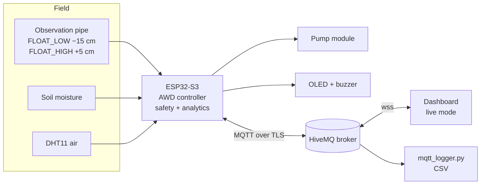

# Smart Rice Farm

**AIoT irrigation for rice paddies using Safe AWD (Alternate Wetting and Drying).**
An ESP32-S3 lets the field water drop to **15 cm below** the soil surface, then pumps it back to
**5 cm above**, and repeats. This follows IRRI's Safe AWD guideline: less water, no yield loss.

Built for a national innovation competition in Thailand as a working scale model (5 V pump), with
the real AWD control logic, an offline simulator for the presentation and a live dashboard.

| | |
|---|---|
| Firmware | ESP32-S3 (PlatformIO, Arduino): floats, pump, soil moisture, DHT11, OLED, buzzer, Wi-Fi portal, MQTT over TLS |
| Dashboard | Vite + React + TypeScript: simulator with six scenarios, live mode over MQTT/WebSockets, presentation mode |
| Offline demo | `presentation.html`: one file, double-click, no internet |
| Hosted | **https://smart-rice-farm.vercel.app** (Vercel, auto-deploys `web/` on every push to `main`) |

## How it works



The perforated pipe's water level equals the field's water level, above or below the soil.

| FLOAT_LOW (−15) | FLOAT_HIGH (+5) | Pump |
|---|---|---|
| DRY | DRY | ON: start filling |
| WET | DRY | **keep** (the controller remembers whether it is filling or drying) |
| WET | WET | OFF |
| DRY | WET | OFF + fault `FLOAT_CONFLICT` |

Also: FLOOD and OFF modes, a crop calendar that floods around flowering, a pump run limit
(`PUMP_TIMEOUT`), latched faults, a soil-moisture cross-check for a stuck float, and simple
on-device cycle statistics. Details: [docs/control-logic.md](docs/control-logic.md).

**All decisions are made on the ESP32.** Wi-Fi, MQTT and the display never block the control
loop; irrigation keeps working with no network.

## One logic, tested twice

The controller is written once in pure C++ (`firmware/lib/AwdCore`) and ported to TypeScript
(`web/src/logic`). Both are tested against the same file, `shared/awd-test-vectors.json`, so the
simulator on the projector behaves exactly like the device.

```sh
cd firmware && pio test -e native     # C++ on the PC
cd web && npm test                    # TypeScript (vectors + scenarios + live model)
```

## Quick start

### Firmware

Hardware and wiring: [docs/wiring.md](docs/wiring.md).

```sh
cd firmware
pio run -t upload --upload-port COM4
pio device monitor -b 115200          # type `help`
```

On first boot the board opens the Wi-Fi access point `SRF-Setup-<id>`. Join it from a phone, pick
the farm Wi-Fi (2.4 GHz) and save. The MQTT fields are pre-filled for the HiveMQ public broker.
The OLED network page then shows the IP, MQTT status and the board's **topic root**.

### Dashboard

```sh
cd web
npm ci
npm run dev             # http://localhost:5173
npm run build           # hosted site -> dist/
npm run build:single    # offline file -> dist-single/presentation.html
npm run screenshots     # layout check at 1920x1080, 1280x720, 1024x768
```

### Logger

```sh
pip install paho-mqtt==2.1.0
python tools/mqtt_logger.py --root <topic root from the OLED>   # writes logs/state.csv, logs/events.csv
```

## Demo

See [docs/presentation.md](docs/presentation.md) for the script. Short version: open
`presentation.html`, press `F` (fullscreen), `P` (presentation mode) and `T` (guided tour through
the six scenarios). Switch to **Live** to show the real scale model.

## MQTT

Topics `<root>/<deviceId>/{state,event,config,status,cmd}`, JSON payloads. The full contract is in
[docs/mqtt.md](docs/mqtt.md).

The demo uses the **HiveMQ public broker**, which is open to everyone. The device uses TLS and a
random topic root and validates every command, and its safety limits cap what any command can do.
That is fine for a 5 V scale model, but **a real deployment needs a private broker** with logins
(HiveMQ Cloud is supported). Never commit a real topic root; rotate it over USB with
`mqtt root new`.

## Honest about "AI"

The on-device intelligence is simple statistics: cycle drying and fill times, averages, a
next-irrigation **estimate** and SLOW_FILL / FAST_DRAIN anomaly flags. Everything is logged so a
model can be trained later. In the simulator, soil moisture and weather are simulated and labelled
as such, and live mode never draws a water level the floats can't measure.

## Repository

```
firmware/        PlatformIO project (AwdCore library = pure C++ logic)
web/             simulator + live dashboard
shared/          awd-test-vectors.json (used by both test suites)
tools/           mqtt_logger.py, local Mosquitto config
docs/            wiring, MQTT contract, control logic, presentation script, original spec
```
