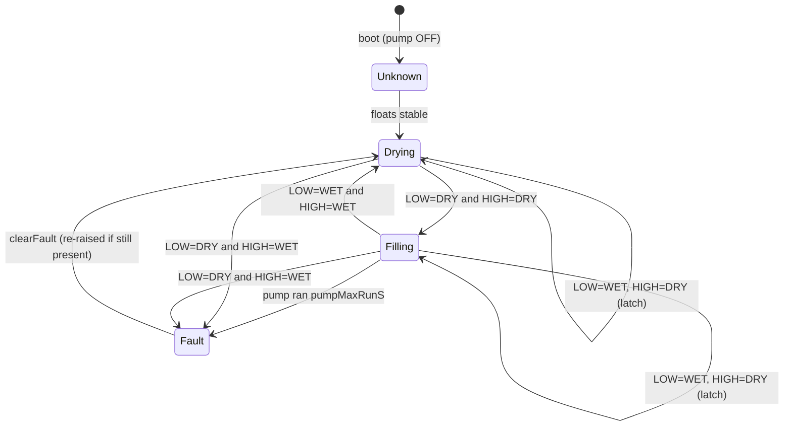

# Control logic

The controller is `firmware/lib/AwdCore` (pure C++, no Arduino calls) and its TypeScript port
`web/src/logic`. Both are tested against `shared/awd-test-vectors.json`, so the simulator on the
projector runs exactly the logic that runs on the ESP32.

## Water levels

The observation pipe is 30 cm long: 20 cm in the soil, 10 cm above it. Levels are relative to
the soil surface.

| Level | Meaning |
|---|---|
| +10 cm | top of the pipe |
| **+5 cm** | `FLOAT_HIGH`: stop filling (25 cm from the pipe bottom) |
| 0 cm | soil surface |
| **−15 cm** | `FLOAT_LOW`: start filling (5 cm from the pipe bottom), IRRI Safe AWD threshold |
| −20 cm | bottom of the pipe |

## Float readings and debounce

Each float is read as **WET** (water at or above it) or **DRY**. Whether a closed switch means WET
is a config flag for each float (`FLOAT_LOW_CLOSED_IS_WET`, `FLOAT_HIGH_CLOSED_IS_WET`), applied
before the controller sees the reading.

A new reading only counts after it has been stable for `debounceS` (default 3 s). Until both floats
have a stable reading after boot, the zone is `UNKNOWN` and the pump stays OFF.

## Zones

| FLOAT_LOW | FLOAT_HIGH | Zone |
|---|---|---|
| DRY | DRY | `BELOW` (below −15 cm) |
| WET | DRY | `BETWEEN` |
| WET | WET | `ABOVE` (at or above +5 cm) |
| DRY | WET | `INVALID` (impossible) |
| not yet stable | | `UNKNOWN` |

## AWD mode: state table

| FLOAT_LOW (−15) | FLOAT_HIGH (+5) | Pump |
|---|---|---|
| DRY | DRY | ON: start filling (`filling = true`) |
| WET | DRY | **keep the current state** (the latch) |
| WET | WET | OFF: stop filling (`filling = false`) |
| DRY | WET | OFF + fault `FLOAT_CONFLICT` |

In the middle band the floats read the same while the field is filling and while it is drying. The
`filling` flag remembers which one is happening. At boot it is false, so a field in the middle band
starts out drying.

## Modes

| Mode | Behaviour |
|---|---|
| `AWD` | the state table above |
| `FLOOD` | FLOAT_HIGH only: DRY → ON, WET → OFF. After the pump stops it stays off for at least `pumpMinOffS` (60 s). The first run after boot may start immediately. |
| `OFF` | the pump never runs automatically |

**Timed fill** (`timedFillS` > 0, AWD only): for a build where FLOAT_HIGH is unavailable. When
FLOAT_LOW is DRY the pump runs for `timedFillS` seconds, then rests at least `pumpMinOffS` before
another run, so a field that stays dry is not pumped nonstop. FLOAT_HIGH going WET still stops it
early, and `timedFillS` must stay below `pumpMaxRunS`. With `timedFillS` = 0 (the default) the
classic float table applies. The scale model currently uses `timedFillS` = 30.

Switching mode keeps an ongoing fill (AWD → FLOOD in the middle band keeps filling up to +5 cm).
Switching to `OFF` stops it.

**Manual pump** (`{"cmd":"pump","on":true,"seconds":N}`): runs for N seconds, capped at
`pumpMaxRunS`, then the current mode takes over again (the latch is reset, so in the middle band
the pump stops). A manual run is refused while a fault is latched. `on:false` cancels a manual run
and stops an automatic fill; in AWD with both floats DRY the pump restarts on the next tick, so use
mode `OFF` to stop for good.

**Fill now** (`{"cmd":"fill"}`, console `fill`): starts a fill at once, even in the middle band
where AWD would wait for FLOAT_LOW to go DRY. The pump runs until FLOAT_HIGH reads WET, exactly
like an automatic fill, so `PUMP_TIMEOUT` still applies. Refused during a fault, in `OFF` mode, or
when FLOAT_HIGH is not DRY.

## Safety

- The pump is OFF at boot, while floats are unknown, during any fault, and on a crash (the task
  watchdog resets the chip, and boot drives the pin LOW first).
- **`PUMP_TIMEOUT`**: if an automatic run lasts `pumpMaxRunS` (default 300 s) without FLOAT_HIGH
  going WET, the pump stops and the fault latches. Possible causes: empty source, pump running dry,
  a leak or a stuck float.
- **Resets do not reset the run limit.** The auto run time of an unfinished fill is kept in RTC
  memory (it survives a software reset, the watchdog and a brownout, not a full power-off) and
  counts toward `pumpMaxRunS` after the restart, so a board that keeps resetting while the pump
  runs still hits `PUMP_TIMEOUT`. A run that ends normally carries nothing over. `state` and the
  `boot` event include `resetReason`.
- **`FLOAT_CONFLICT`**: LOW=DRY with HIGH=WET is physically impossible, so it means a stuck float
  or a wiring fault. It is checked in every mode.
- Faults latch until `clearFault`. The first fault wins. Faults are not stored across a reboot;
  they come back if the condition is still there (a conflict immediately, a timeout after the
  next failed run).
- **Soil moisture backup**: if soil moisture stays below `soilDryAlertPct` (30%) for
  `soilBackupDelayS` (600 s) while FLOAT_LOW still reads WET, the warning `FLOAT_LOW_SUSPECT` is
  raised. It clears when the soil is wet again or FLOAT_LOW reads DRY. With
  `soilBackupCanStartPump = true` (default false), the moment the warning is raised it also starts
  one fill in AWD mode, which then ends normally at +5 cm.
- A failed soil or DHT11 reading is reported but never stops irrigation (an invalid soil reading
  simply counts as "not dry").

## Crop schedule

If both a transplant date and an expected flowering date are set (and flowering is after
transplanting), the mode follows the calendar date in Asia/Bangkok:

| Stage | Days | Mode |
|---|---|---|
| `PRE_TRANSPLANT` | before transplanting | no change |
| `ESTABLISHMENT` | transplant day 0–13 (`FLOOD_AFTER_TRANSPLANT_DAYS` = 14) | FLOOD |
| `VEGETATIVE` | from day 14 until 8 days before flowering | AWD |
| `FLOWERING` | flowering −7 … +7 days (inclusive) | FLOOD |
| `RIPENING` | after that, until harvest | AWD |

The flowering window takes priority if it overlaps the establishment period. Without a schedule,
the mode set by command is kept.

## Analytics (on-device, honest)

Only clean automatic AWD cycles are measured:

- **Drying time**: pump OFF (after FLOAT_HIGH went WET) → FLOAT_LOW goes DRY.
- **Fill time**: pump ON → FLOAT_HIGH goes WET.

A cycle (drying + the fill that follows) is stored when the fill completes. Cycles are discarded if
a manual run, a mode change or a non-AWD mode happens during them, or if a fill ends without
FLOAT_HIGH going WET (for example `PUMP_TIMEOUT`). The first fill after
boot has no measured drying time, so it is not stored.

- The last 10 cycles are kept (in NVS on the device). Averages are integer seconds, rounded half up.
- **Next irrigation estimate** = last pump-off time + average drying time. It is only shown while
  the field is drying and at least one cycle is recorded, and it is always labelled as an estimate.
- Anomaly flags, evaluated once at least 3 earlier cycles exist and replaced every cycle:
  - `SLOW_FILL`: fill time > 2 × the average (weak source or a leak).
  - `FAST_DRAIN`: drying time < 0.5 × the average (possible leak in the bund).

## Test vectors

`shared/awd-test-vectors.json`:

- `cases[]`: `{name, config?, mode?, steps[]}`. Each step is
  `{t, low?, high?, soil?, cmd?, expect?}`.
  - `t` is in seconds. Exactly one controller tick, then one analytics update, runs at each step.
  - `low`, `high` and `soil` stay as set until a later step changes them. `soil` starts invalid.
  - `cmd` uses the MQTT command JSON (`setMode`, `pump`, `fill`, `clearFault`, `setConfig`) and is applied
    before the tick.
  - `expect` keys are optional: `pump`, `filling`, `manual`, `cmdOk`, `mode`, `zone`,
    `fault` (null = none), `pumpRunS`, `warnings`, `events` (exact set from the command and the
    tick), `cycles`, `avgDryingS`, `avgFillS`, `analyticsWarnings` and `nextIrrigationAtS`
    (null = no estimate).
- `schedule[]`: `{transplant, flowering, date, stage, mode}`.

Run them with `cd firmware && pio test -e native` and `cd web && npm test`.
